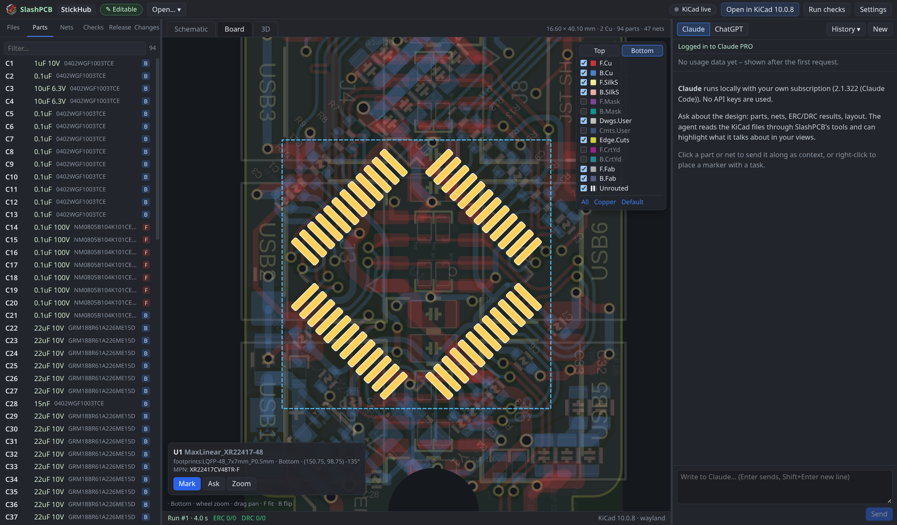
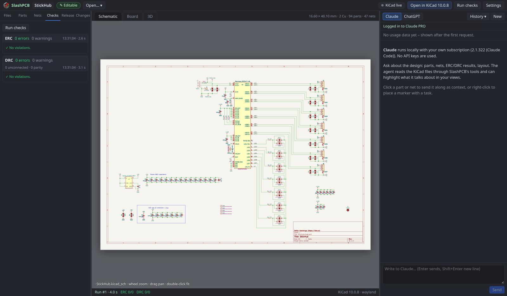
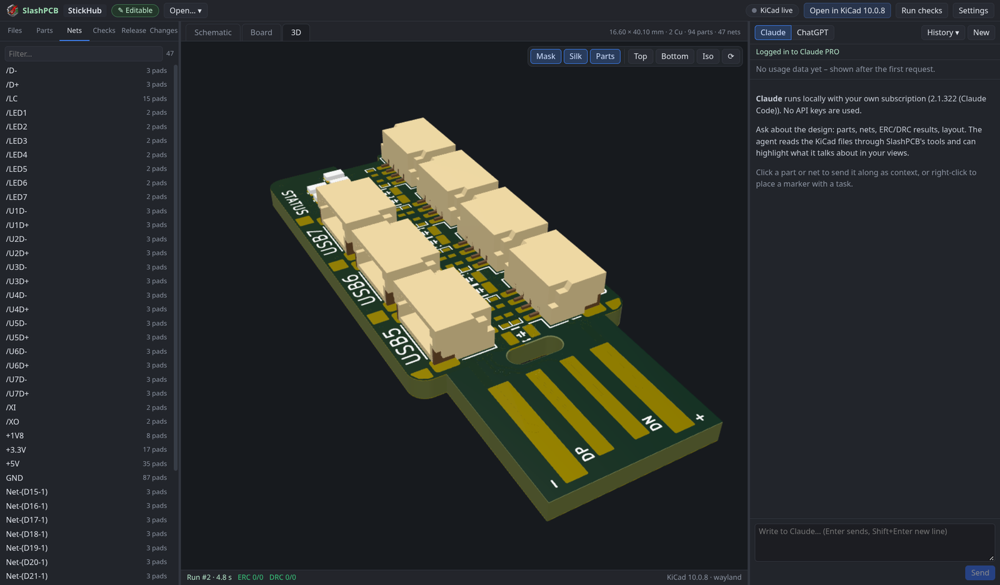
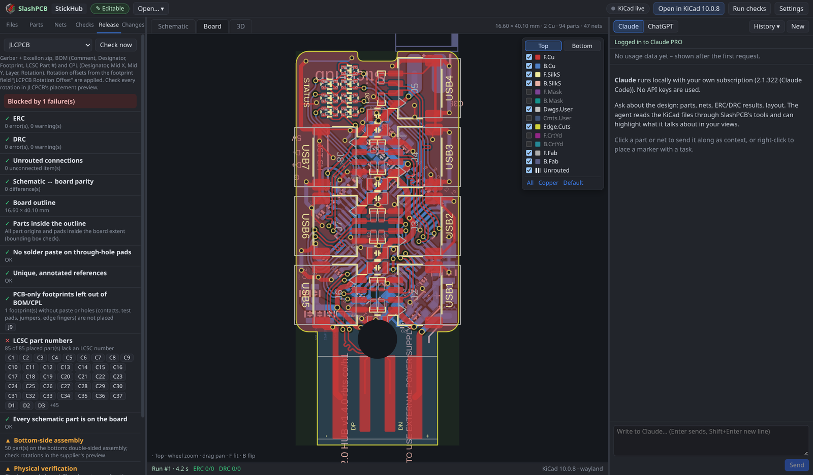
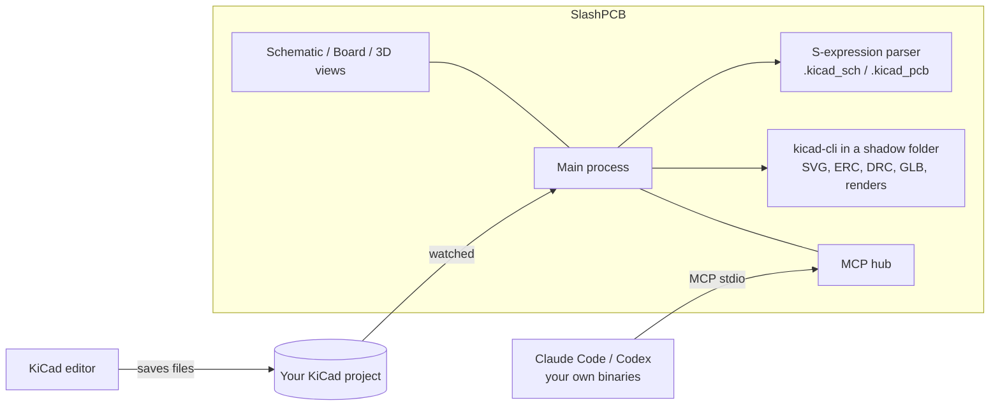

<p align="center">
  
</p>

<h1 align="center">SlashPCB</h1>

<p align="center">
  A local workbench for KiCad projects where AI agents review your schematics and boards while you watch, steer and mark.
</p>

---

SlashPCB puts live schematic, board and 3D views of a KiCad project between you and an AI agent (**Claude Code** or **ChatGPT (Codex)**, on your own subscription). The agent reads the design, runs checks, highlights what it talks about and, when you ask, makes small changes you approve.

SlashPCB is a sibling of [SlashCAD](https://github.com/slashmad/slashcad). It is a cockpit around KiCad: **KiCad stays the editor, and its files stay the source of truth.**

> Status: early (0.7.1). Review-first: the agents read the design, run checks, highlight and render. Changes go through KiCad's own editor (live link, undoable there) or small field edits you approve.

| Board, with a part selected | Schematic with background ERC/DRC |
|---|---|
|  |  |
| **3D with mask, silkscreen and parts toggles** | **Release package preflight (JLCPCB)** |
|  |  |

<sub>Screenshots show StickHub, a KiCad demo project by Stefan Hamminga (rbts.co), CC BY-NC-SA 4.0. See [docs/screenshots](docs/screenshots/README.md).</sub>

## What it does

- **Opens a KiCad project** (folder, `.kicad_pro`, `.kicad_sch` or `.kicad_pcb`) and shows it in three tabs:
  - **Schematic:** KiCad's own SVG plot of every sheet (hierarchical sheets as tabs), with selection, highlights and ERC markers on top.
  - **Board:** a fast 2D view of copper, zones, pads, vias, silkscreen and fab layers from the parsed `.kicad_pcb`. It has per-layer visibility, a top/bottom flip, net and part highlighting, and DRC markers.
  - **3D:** KiCad's GLB export with parts, copper, silkscreen and solder mask.
- **Runs ERC and DRC (with schematic parity) in the background** after every save, and lists the violations. A click jumps to the spot.
- **Cross-probes:** a part picked in a list, the schematic or the board is selected everywhere.
- **Markers:** right-click anywhere to place a numbered marker with a task for the agent.
- **Agent chat** with Claude Code or Codex on your own subscription. The agents get a local MCP server with KiCad-aware tools:
  `get_design`, `list_components`, `get_component`, `list_nets`, `get_net`, `run_checks`, `render_view` (board, schematic sheet or 3D render), `highlight`, `list_annotations`, `resolve_annotation`. With the live link, they also get `kicad_live_status`, `kicad_select`, `kicad_move`, `kicad_set_value`, `kicad_refill_zones` and `kicad_save`, plus `set_fields` for file edits, `release_preflight`, `export_release` and `list_releases` for packages, `compare_revision`, `list_rules`, `add_rule`, `remove_rule`, `polarity_review`, `layout_metrics` and `design_hints`. Both Claude and Codex run the read-only tools without asking and ask you before any change.
- **Live link to KiCad (optional):** through KiCad's IPC API (kicad-python). It mirrors selection between KiCad's PCB editor and SlashPCB. Agents can select, move or rotate footprints and change values in the open editor. Each change is one undo step in KiCad, and nothing is saved unless you ask. Turn it on under **KiCad live** in the top bar. **Set up live link** creates a Python environment in SlashPCB's data folder and installs `kicad-python`. You start that step yourself, and it is the only one that uses the network.
- **Field edits:** `set_fields` writes MPN, LCSC, Value or any other field into the schematic, and optionally onto the board footprints. Each edit changes only the bytes of that property and writes atomically, and DRC parity reports any remaining mismatch. Edits are refused for frozen projects and for files open in KiCad.
- **Release packages** (Release tab, or the agent tools `release_preflight` and `export_release`). Profiles cover JLCPCB, PCBWay and generic KiCad output. A preflight blocks a package when the board fails ERC, DRC, unrouted, parity or outline checks, or when part numbers are missing. It also warns about paste on THT pads, bottom-side assembly and footprints that look like parts but have no paste. The export writes a Gerber and Excellon zip, a BOM and a CPL in the supplier's columns (with JLCPCB rotation offsets), and a `MANIFEST.json` with SHA-256 hashes. A failed preflight is recorded in the package as `PREFLIGHT_FAILED_DO_NOT_ORDER`. The package is bound to the exact input files its checks ran on: their hashes are taken before the checks and compared after the export, and a project saved in between marks the package folder `-INVALID`. Board-only footprints such as key contacts, test pads and edge fingers (no paste, no holes) are kept out of the BOM and CPL.
- **3D view** with KiCad's colours (black mask stays black, ENIG stays gold) and toggles for mask, silkscreen and parts. Hide the mask to see the copper.
- **Design invariants** (Checks › Rules, `slashpcb.rules.json` next to the project): constraints DRC cannot know, for example "pad 1 of the matrix diodes is on a COL net", "U1 keeps its land pattern", "In2.Cu carries only GND" (tracks, zones, SMD pads and copper graphics; vias and through-hole pads pass through), "the key contacts do not move" and "no design rule is relaxed below the baseline". They are checked on every run and block release packages. An unreadable rules file, an unknown rule kind or a rule with missing fields is a blocking error, never "no rules", and SlashPCB does not overwrite such a file. For a frozen project, rules you add or remove live in SlashPCB's own copy and the project's file is never changed. Agents can propose rules (`add_rule`, with your approval).
- **Polarity and pin-1 review** (Checks › Polarity, `polarity_review`): every IC, transistor, diode, LED, polarized capacitor and connector with pad numbers, pin names and nets. Contradictions are flagged (a ground pin on a signal net, a supply pin on ground, an NC pin that is connected, an unflipped bottom-side copy). You tick parts as verified against the datasheet. The tick records what you reviewed (part and MPN, placement, pad numbers, nets, sizes and shapes, schematic pin names, library footprint version), and a change to any of them clears it and says what changed. A land pattern whose pin order differs from the real package is invisible to DRC and the netlist, so this review is the safeguard.
- **Land patterns against a trusted reference**: every polarized part is compared with its library footprint, and a `land_pattern` rule compares parts with a reference you trust (for example the maker's land pattern). This catches the same pad positions with a different pad numbering, and bottom-side copies that were not mirrored. Neither DRC nor the netlist can see these errors. A match is strict: every pad must have exactly one counterpart with the same number, position, size, shape, type and drill (mask and paste apertures are not compared).
- **Layout review** (Checks › Layout, `layout_metrics`, `design_hints`): track length per layer, segments and arcs, short and off-45° segments, direction changes, vias per net, the largest detours, differential-pair length differences and zone islands, compared before and after in the Changes tab. Also checked: vias whose ring reaches a pasted pad, IC supply pins without nearby decoupling, test pads with paste or without room for a Ø0.5 mm probe, and duplicated UUIDs.
- **Solder-mask webs:** every pad opening (pad copper grown by the pad, footprint or board mask expansion) is measured against its neighbours on the same side, with open vias included when the supplier does not tent. Webs between different nets that are narrower than the supplier's minimum are reported, because CAM usually removes them and leaves no mask between the pads. Footprints where KiCad allows bridges are kept apart, and mask-defined lands (negative expansion) are listed for the fabricator. The result shows in Checks › Layout, `design_hints`, the preflight and `BUILD_SPEC.md`.
- **Sourcing notes** (Parts tab, `list_parts`, `set_part_note` with approval): offline notes per BOM line, keyed by MPN, for lifecycle (active, NRND, EOL, obsolete), customer-supplied parts, approved alternates, lead time and a quote with an explicit currency. They are stored in `slashpcb.parts.json` next to the project, or in SlashPCB's data folder when the project is frozen. The preflight warns about parts that are not active, `BUILD_SPEC.md` lists customer-supplied parts and alternates, and packages get a separate `sourcing-notes.csv`, so the supplier's BOM template stays unchanged. Nothing is looked up online.
- **Supplier limits** in the release profiles (Aisler, DanishPCB and Eurocircuits are added, and you can enter your own limits per profile): smallest track, drill, via and pad ring versus the supplier, the board's own clearance rule versus the supplier's gap, ordered thickness versus design thickness, tented vias for suppliers that do not tent, and the minimum solder-mask web.
- **Package read-back and review material**: every file the Gerber job lists must exist, and every via, plated and non-plated hole and slot must appear in the drill files at its position with its tool size. Packages include assembly drawings (top/bottom PDF), every layer as SVG with an index page, an optional PCBA STEP and a generated `BUILD_SPEC.md` (stack, finish, colours, smallest features, tenting, no-paste pads, fine-pitch parts).
- **Rule-relaxation guard**: suppressed checks and DRC exclusions are reported in the preflight, and revision comparison lists design-rule changes (lowered minimums, checks set to ignore, new exclusions, changed custom rules).
- **Revision comparison** (Changes tab, or the agent tool `compare_revision`) against another revision folder or a Git commit. Besides parts and nets it reports DNP and other assembly attributes, added, removed and resized pads, and outline, keepout and stack changes, and it states what it does not compare (3D models, silkscreen, zone fills). It lists added, removed, moved, rotated and flipped parts, plus value, footprint, field and pad-net changes and board totals, and marks them on the board. The other revision is only read.
- **Unrouted connections** from DRC are drawn on the board like a ratsnest. Double-click a sheet symbol to enter the sheet.
- **Approvals:** read-only tools run freely. Tools that change something ask you first in the chat.
- **Safety for released designs:** a project with a release marker (`*FINAL_MANIFEST*.json`, `FROZEN`) or a read-only folder is shown as **frozen**, and agents are told never to edit it. Open KiCad editors are detected from KiCad's lock files.

## Install

Download a package from the [Releases](../../releases) page:

| System  | File | Notes |
|---------|------|-------|
| Linux   | `SlashPCB-<version>-x86_64.AppImage` | `chmod +x` and run. Adds itself to the application menu on first start. |
| Debian, Ubuntu | `slashpcb_<version>_amd64.deb` | `sudo apt install ./slashpcb_<version>_amd64.deb` |
| Fedora, openSUSE | `slashpcb-<version>.x86_64.rpm` | `sudo dnf install ./slashpcb-<version>.x86_64.rpm` |
| Windows | `SlashPCB-Setup-<version>.exe` | Installer (per user, choice of folder). |
| Windows | `SlashPCB-Portable-<version>.exe` | Single exe; keeps its settings in `SlashPCB-data` next to it. |
| Windows | `SlashPCB-<version>-win-x64.zip` | Unzip and run `slashpcb.exe`; starts faster than the portable exe. |

SlashPCB does not bundle KiCad or the agents. You need:

- **KiCad 9 or 10.** SlashPCB finds `kicad-cli` in the usual install locations (Linux packages and Flatpak, `C:\Program Files\KiCad\<version>\bin`, the macOS app bundle) or in *Settings › KiCad*.
- At least one agent CLI, installed and logged in: **Claude Code** with a Claude subscription, or **Codex** with a ChatGPT login. The CLIs and the VS Code extensions both work, and SlashPCB finds them the same way SlashCAD does.

Windows packages are cross-built on Linux and have had less testing than the Linux packages.

## How it works



- **No extra credits:** the app calls no LLM API and needs no API keys. Before every session and every turn it checks that the agent CLI is logged in with a subscription (Claude: claude.ai, Codex: ChatGPT) and refuses to start on API billing, a missing login or an unreadable login status. It starts your own `claude` / `codex` binaries, logged in with your own subscription, and strips API-key variables from their environment.
- **The app writes nothing into your project except what you ask for:** `slashpcb.rules.json` and `slashpcb.parts.json` when you add rules or sourcing notes (into SlashPCB's data folder instead for frozen projects), and field edits you approve. `kicad-cli` writes a `.kicad_prl` file next to a project when one is missing. To avoid that, every kicad-cli run happens in a shadow folder under SlashPCB's data folder. There, the project and local-settings files are copies and everything else is linked.
- **Everything is local:** no telemetry and no uploads. Online part data (stock and prices) is planned as an opt-in that is off by default.

## How it was tested

The parsers are checked against KiCad's own netlists for the KiCad demo projects (`npm test`). The checks were also tested on copies of a large local project with about 50 revisions, where the right answers were already known. Board, schematic and CPL output match what was delivered for one revision. A revision with mirrored bottom-side land patterns is flagged against the corrected reference. The vias at paste openings, supplier limits, test-pad access, the narrowest solder-mask web and the mask-defined lands, and the build specification match that project's own reviews.

## Requirements

- KiCad 9 or 10 (`kicad-cli` on PATH, the default install location, or set in Settings › KiCad). The Fedora RPM and Flatpak are detected.
- For the live link: Python 3.11–3.13 (kicad-python's `pynng` has no wheels for 3.15 yet), plus KiCad's API server enabled in Preferences › Plugins.
- Claude Code and/or Codex, for example the VS Code extensions or the CLIs.

## Build and run

```sh
npm install
npm run build
npm start                 # Wayland first on Linux, X11 fallback
npm run typecheck
npm test                  # parser checks against kicad-cli netlists (needs samples/ and kicad-cli)
npm run dist:linux        # AppImage, deb, rpm
npm run dist:win          # Setup, portable exe, zip (cross-builds on Linux)
```

macOS packages are built by the manual GitHub Actions workflow (`.github/workflows/build.yml`).

## Layout

| Path | Role |
|---|---|
| `src/main/kicad/` | S-expression reader, board and schematic parsers, kicad-cli runner, shadow folder, ERC/DRC reports, field edits, live-link client |
| `python/kicad_bridge.py` | Live link to a running KiCad (kicad-python) |
| `src/main/project.ts` | Project: file tree, watcher, locks, frozen detection, background pipeline |
| `src/main/tools.ts` | MCP tools for agents |
| `src/main/agents/` | Claude Code / Codex bridges (shared with SlashCAD) |
| `src/renderer/` | React UI: board canvas renderer, schematic view, 3D view, panels |
| `test/` | Parser checks |

## Licence

MIT. See [LICENSE](LICENSE) and [THIRD-PARTY-NOTICES.md](THIRD-PARTY-NOTICES.md).

## Support

Like SlashPCB? Buy me a beer 🍺

[](https://ko-fi.com/slashmad)
[](https://liberapay.com/slashmad/)
