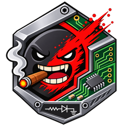
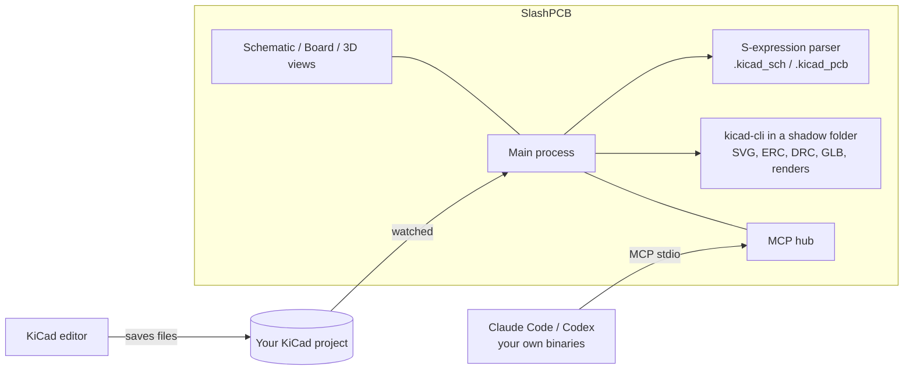

<p align="center">
  
</p>

<h1 align="center">SlashPCB</h1>

<p align="center">
  A local workbench for KiCad projects where AI agents review your schematics and boards while you watch, steer and mark.
</p>

---

SlashPCB puts live schematic, board and 3D views of a KiCad project between you and an AI agent (**Claude Code** or **ChatGPT (Codex)**, on your own subscription). The agent reads the design, runs checks, highlights what it talks about and, when you ask, makes small changes you approve.

SlashPCB is a sibling of [SlashCAD](https://github.com/slashmad/slashcad). It is a cockpit around KiCad: **KiCad stays the editor, and its files stay the source of truth.**

> Status: early (0.2). Review-first: the agents read the design, run checks, highlight and render. Changes go through KiCad's own editor (live link, undoable there) or small field edits you approve.

## What it does

- **Opens a KiCad project** (folder, `.kicad_pro`, `.kicad_sch` or `.kicad_pcb`) and shows it in three tabs:
  - **Schematic:** KiCad's own SVG plot of every sheet (hierarchical sheets as tabs), with selection, highlights and ERC markers on top.
  - **Board:** a fast 2D view of copper, zones, pads, vias, silkscreen and fab layers from the parsed `.kicad_pcb`. It has per-layer visibility, a top/bottom flip, net and part highlighting, and DRC markers.
  - **3D:** KiCad's GLB export with parts, copper, silkscreen and solder mask.
- **Runs ERC and DRC (with schematic parity) in the background** after every save, and lists the violations. A click jumps to the spot.
- **Cross-probes:** a part picked in a list, the schematic or the board is selected everywhere.
- **Markers:** right-click anywhere to place a numbered marker with a task for the agent.
- **Agent chat** with Claude Code or Codex on your own subscription. The agents get a local MCP server with KiCad-aware tools:
  `get_design`, `list_components`, `get_component`, `list_nets`, `get_net`, `run_checks`, `render_view` (board, schematic sheet or 3D render), `highlight`, `list_annotations`, `resolve_annotation`. With the live link, they also get `kicad_live_status`, `kicad_select`, `kicad_move`, `kicad_set_value`, `kicad_refill_zones` and `kicad_save`, plus `set_fields` for file edits.
- **Live link to KiCad (optional):** through KiCad's IPC API (kicad-python). It mirrors selection between KiCad's PCB editor and SlashPCB. Agents can select, move or rotate footprints and change values in the open editor. Each change is one undo step in KiCad, and nothing is saved unless you ask. Turn it on under **KiCad live** in the top bar. **Set up live link** creates a Python environment in SlashPCB's data folder and installs `kicad-python`. You start that step yourself, and it is the only one that uses the network.
- **Field edits:** `set_fields` writes MPN, LCSC, Value or any other field into the schematic, and optionally onto the board footprints. Each edit changes only the bytes of that property and writes atomically, and DRC parity reports any remaining mismatch. Edits are refused for frozen projects and for files open in KiCad.
- **Unrouted connections** from DRC are drawn on the board like a ratsnest. Double-click a sheet symbol to enter the sheet.
- **Approvals:** read-only tools run freely. Tools that change something ask you first in the chat.
- **Safety for released designs:** a project with a release marker (`*FINAL_MANIFEST*.json`, `FROZEN`) or a read-only folder is shown as **frozen**, and agents are told never to edit it. Open KiCad editors are detected from KiCad's lock files.

## How it works



- **No extra credits:** the app calls no LLM API and needs no API keys. It starts your own `claude` / `codex` binaries, logged in with your own subscription, and strips API-key variables from their environment.
- **Nothing is written into your project by the app.** `kicad-cli` writes a `.kicad_prl` file next to a project when one is missing. To avoid that, every kicad-cli run happens in a shadow folder under SlashPCB's data folder. There, the project and local-settings files are copies and everything else is linked.
- **Everything is local:** no telemetry and no uploads. Online part data (stock and prices) is planned as an opt-in that is off by default.

## Requirements

- KiCad 9 or 10 (`kicad-cli` on PATH, the default install location, or set in Settings › KiCad). The Fedora RPM and Flatpak are detected.
- For the live link: Python 3.11–3.13 (kicad-python's `pynng` has no wheels for 3.15 yet), plus KiCad's API server enabled in Preferences › Plugins.
- Claude Code and/or Codex, for example the VS Code extensions or the CLIs.

## Build and run

```sh
npm install
npm run build
npm start                 # Wayland first on Linux, X11 fallback
npm run typecheck
npm test                  # parser checks against kicad-cli netlists (needs samples/ and kicad-cli)
npm run dist:linux        # AppImage, deb, rpm
```

## Layout

| Path | Role |
|---|---|
| `src/main/kicad/` | S-expression reader, board and schematic parsers, kicad-cli runner, shadow folder, ERC/DRC reports, field edits, live-link client |
| `python/kicad_bridge.py` | Live link to a running KiCad (kicad-python) |
| `src/main/project.ts` | Project: file tree, watcher, locks, frozen detection, background pipeline |
| `src/main/tools.ts` | MCP tools for agents |
| `src/main/agents/` | Claude Code / Codex bridges (shared with SlashCAD) |
| `src/renderer/` | React UI: board canvas renderer, schematic view, 3D view, panels |
| `test/` | Parser checks |

## Licence

MIT. See [LICENSE](LICENSE) and [THIRD-PARTY-NOTICES.md](THIRD-PARTY-NOTICES.md).

## Support

Like SlashPCB? Buy me a beer 🍺

[](https://ko-fi.com/slashmad)
[](https://liberapay.com/slashmad/)
